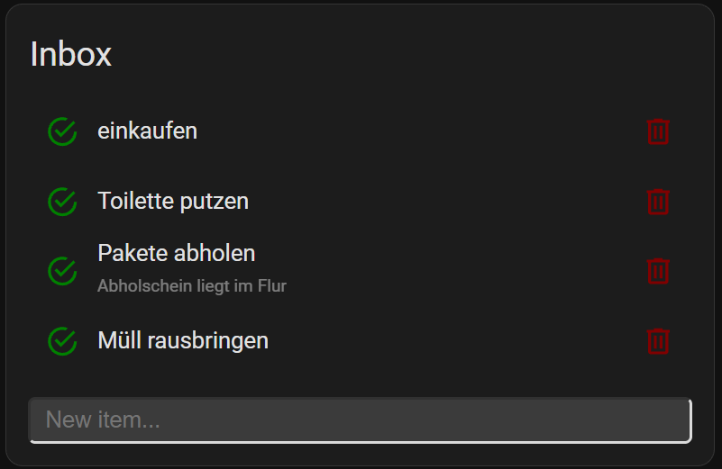
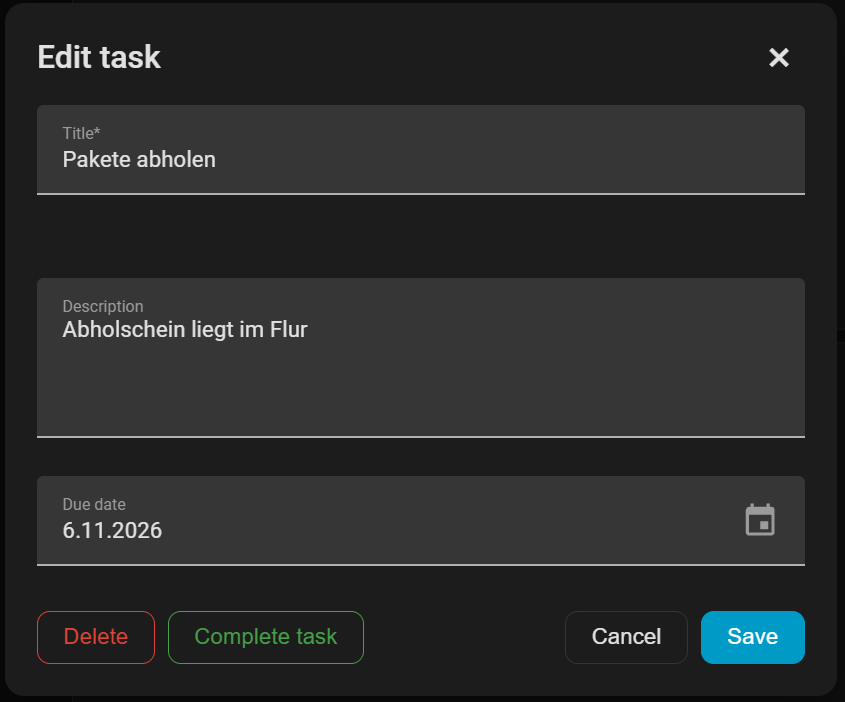
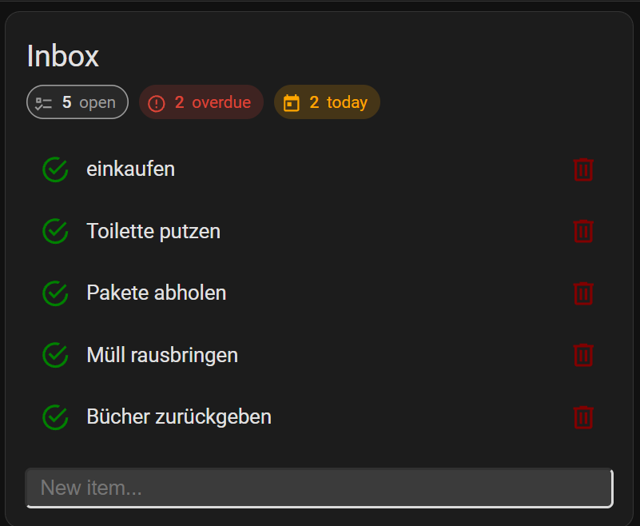
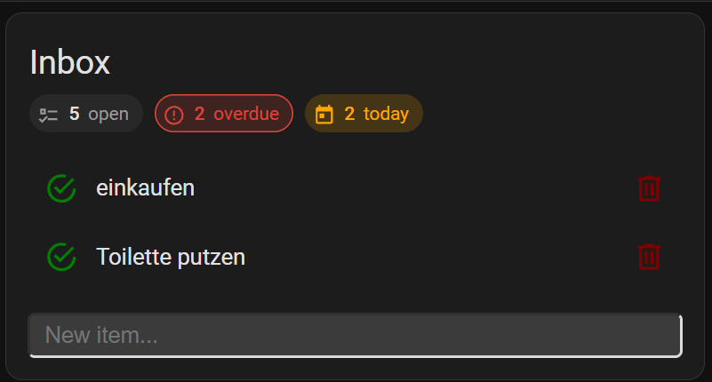

# Todoist Card

[](https://hacs.xyz)


A [Home Assistant](https://www.home-assistant.io) Lovelace card for your Todoist tasks. It uses the official [Todoist integration](https://www.home-assistant.io/integrations/todoist/), so there is **no YAML, no token handling and no restart** needed: install the card, pick the list, done.

You can show the tasks of a project, add, complete, edit and delete them.

> Want sections, priorities and labels? That needs an additional REST setup, see [Full setup (REST)](docs/full-setup.md).

> [!NOTE]
> This is a maintained fork of [grinstantin/todoist-card](https://github.com/grinstantin/todoist-card), which was discontinued. The original card stopped working when Todoist shut down the Sync API v9 and REST API v2 on 2026-02-10.
> If you used the original card, see [Migrating from the original card](docs/full-setup.md#migrating-from-the-original-card).

<p align="center">
  
  
</p>

## Features

- Shows the tasks of one Todoist project, including descriptions.
- **Complete** tasks with one click and **undo** recently completed ones.
- **Add** tasks with the input field at the bottom.
- **Edit** a task by clicking it (extended mode): title, description and due date.
- **Safe deletion:** deleting asks whether you want to complete the task instead and needs a second confirmation.
- Filter for tasks that are due today or overdue.
- Optional **statistics in the header** (open, overdue, due today, completed) that double as one-click filters.
- Visual editor for the card. It only offers options that work with your selected entity and explains what is missing.
- Works as a read-only list if changing tasks is not possible.

## Requirements

- Home Assistant with the UI-based dashboards (Lovelace). Developed and tested against the current frontend (2026.11).
- The official [Todoist integration](https://www.home-assistant.io/integrations/todoist/) set up in Home Assistant. It creates one `todo` entity per Todoist project, for example `todo.inbox`.
- The browser needs internet access to `cdn.jsdelivr.net`, because the card loads the [Lit](https://lit.dev) library from there.

## Installation

### HACS (custom repository)

1. Open HACS in Home Assistant.
2. Click the three dots in the top right corner and choose **Custom repositories**.
3. Enter `https://github.com/ConstableW/todoist-card` and choose the type **Dashboard** (called _Lovelace_ in older HACS versions).
4. Search for **Todoist Card** in HACS and install it.
5. Reload the browser page (Ctrl+F5). HACS adds the resource automatically.

### Manual

1. Download [`todoist-card.js`](https://raw.githubusercontent.com/ConstableW/todoist-card/main/todoist-card.js).
2. Put the file into the `config/www` folder of Home Assistant.
3. Add it as a resource, either
   - **via UI:** _Settings_ → _Dashboards_ → ⋮ → _Resources_ → _Add resource_ → URL `/local/todoist-card.js`, type `JavaScript Module` (enable _Advanced mode_ in your user profile if you do not see _Resources_), or
   - **via YAML:**
     ```yaml
     lovelace:
       resources:
         - url: /local/todoist-card.js
           type: module
     ```

### Without HACS and without copying files

You can also reference the file directly from GitHub through jsDelivr. Add a resource of type `JavaScript Module` with this URL:

```
https://cdn.jsdelivr.net/gh/ConstableW/todoist-card@COMMIT/todoist-card.js
```

Replace `COMMIT` with the short hash of the [latest commit](https://github.com/ConstableW/todoist-card/commits/main). Do not use `@main`: jsDelivr caches branches for up to 12 hours and ignores `?v=` query strings, so you would not see updates. Do not use `raw.githubusercontent.com` either, it serves the wrong MIME type and the browser refuses to load it as a module.

## Setup

1. **Set up the Todoist integration** in _Settings → Devices & services → Add integration → Todoist_ and enter your [API token](https://app.todoist.com/app/settings/integrations/developer) there. Home Assistant now has a `todo` entity for each of your projects.
2. **Add the card.** Open a dashboard, click the pencil icon (_Edit dashboard_), then _Add card_ and choose **Custom: Todoist Card**.
3. **Select the entity** of your project, for example `todo.inbox`. The editor lists all `todo` entities, so pick the one from the Todoist integration (it is named like your project).

Or use YAML:

```yaml
type: custom:todoist-card
entity: todo.inbox
mode: extended
```

## Options

| Name                 |   Type    |   Default    | Description                                                                                                |
| -------------------- | :-------: | :----------: | ---------------------------------------------------------------------------------------------------------- |
| `type`               | `string`  | **required** | `custom:todoist-card`                                                                                      |
| `entity`             | `string`  | **required** | A `todo` entity of the Todoist integration, for example `todo.inbox`.                                      |
| `mode`               | `string`  | `quick`      | `quick`: complete and delete only. `extended`: clicking a task opens the [edit dialog](#extended-mode).    |
| `show_header`        | `boolean` | `true`       | Show the name of the list as card header.                                                                  |
| `show_completed`     | `integer` | `5`          | Number of recently completed tasks shown at the end of the list (0 to disable).                            |
| `header_stats`       | `string`  | `none`       | Statistics below the header: `chips` (overdue, today, open, completed) or `line` (one line with progress bar). Counts cover all open tasks, even with `only_today_overdue`. Click _overdue_ or _today_ to filter the list, click again (or _open_) to show everything. |
| `show_item_add`      | `boolean` | `true`       | Show the text input for adding new tasks.                                                                  |
| `show_item_close`    | `boolean` | `true`       | Show the _complete_ and _uncomplete_ buttons.                                                              |
| `show_item_delete`   | `boolean` | `true`       | Show the _delete_ buttons.                                                                                 |
| `only_today_overdue` | `boolean` | `false`      | Only show tasks that are due today or overdue.                                                             |

All options can also be set in the visual editor. The options `show_sections` and `use_quick_add` only work with the [full setup](docs/full-setup.md) and are hidden in the editor for `todo` entities.

## Usage

### Actions

- **Circle:** completes the task.
- **Plus** (in the list of recently completed tasks): "uncompletes" the task and adds it back to the list.
- **Trash bin:** asks whether you want to **complete** or **delete** the task. Deleting needs a second confirmation. The gray trash bin in the list of completed tasks only removes the entry from that list, not from Todoist.
- **Input field:** adds a new task after pressing `Enter`.

> The list of recently completed tasks is kept in the browser page and is cleared when the page is reloaded. Todoist itself keeps completed tasks in its history.

### Statistics in the header

Set `header_stats` to show how many tasks need attention. It is off by default and can be changed in the visual editor ("Statistics in the header").

```yaml
type: custom:todoist-card
entity: todo.inbox
header_stats: chips
```

| Value   | Look                                                                                     |
| ------- | ---------------------------------------------------------------------------------------- |
| `none`  | No statistics (default).                                                                  |
| `chips` | Chips for **open**, **overdue**, **today** and **completed**. Chips with a count of 0 are hidden (except _open_). |
| `line`  | One line such as "25 open · 3 today · 2 overdue" with a progress bar for completed tasks. |

<p align="center">
  
  
</p>

Click **overdue** or **today** to show only those tasks. Click the chip again, or **open**, to show everything. The filter is only kept until the page is reloaded.

- The counts cover all open tasks, even if `only_today_overdue` is active.
- _Completed_ counts the recently completed tasks of this browser page (see `show_completed`), not your Todoist history.
- The statistics belong to the header and disappear with `show_header: false`.

### Extended mode

With `mode: extended` a click on the text of a task opens an edit dialog. The circle still completes the task directly.

| Field       | Notes                                                                                                                      |
| ----------- | -------------------------------------------------------------------------------------------------------------------------- |
| Title       | Required.                                                                                                                  |
| Description | Optional, multi-line.                                                                                                      |
| Due date    | Date picker. Clear it to remove the date. Tasks with a time keep their time as long as you do not change the date field.  |

Buttons: **Save** (only sends what you changed), **Cancel** or the × in the corner, **Complete task**, and **Delete** (with the same two-step confirmation as the trash bin).

Priority, labels and sections cannot be changed with the Todoist integration. They are available in the [full setup](docs/full-setup.md).

### What the card does when something is missing

The card checks what is possible and adjusts itself, you do not have to configure that:

- If you select a `sensor` entity from the [full setup](docs/full-setup.md) but `rest_command.todoist` is missing, the card is **read-only**: no input, no complete or delete buttons, and a click on a task opens a details view instead of the edit dialog. The editor then hides the options that cannot work and shows one hint about what is missing.
- If the entity provides no tasks at all, the card says so instead of showing an empty list.

## Troubleshooting

- **The card does not show up in the card list or says "Custom element doesn't exist"**
  The resource is not loaded. Check _Settings → Dashboards → Resources_ and reload the browser with the cache cleared (Ctrl+F5; in the companion app: _Settings → Companion app → Troubleshooting → Reset frontend cache_). The card also needs access to `cdn.jsdelivr.net` for the Lit library.
- **The card is empty or shows "No uncompleted tasks!"**
  Open _Developer tools → States_ and check the `todo` entity. Make sure you selected the entity of the right project. If the card shows "Could not load the tasks: ...", the message comes from Home Assistant.
- **My lists are not in the entity picker**
  The Todoist integration creates one `todo` entity per project. If it is missing, check _Settings → Devices & services → Todoist_.
- **Changes made in Todoist show up late**
  The Todoist integration polls Todoist regularly, so changes made elsewhere can take a moment. Changes made in the card appear immediately.
- **The old version is still shown**
  Reload with the cache cleared (Ctrl+F5). With jsDelivr, use a commit hash in the URL instead of `@main`.
- **The editor of the card looks broken**
  Make sure you run the current version of the card and clear the browser cache.

Please report problems in the [issue tracker](https://github.com/ConstableW/todoist-card/issues).

## Development

The card is a single file, [`todoist-card.js`](todoist-card.js), without a build step. It is a native ES module and loads Lit from jsDelivr. To try changes, copy the file to `config/www`, add it as a resource as described above and reload the browser. The repository is validated with the HACS action on every push.

## Credits and license

Original card by [Konstantin Grinkevich](https://github.com/grinstantin), maintained by [ConstableW](https://github.com/ConstableW) as a fork. Not affiliated with Doist or Todoist.

MIT, see [LICENSE](LICENSE).
