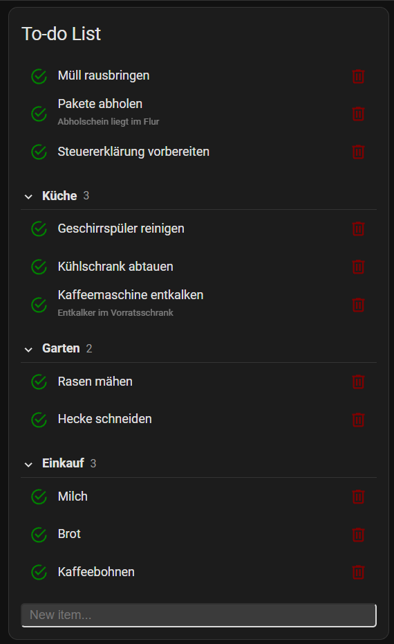
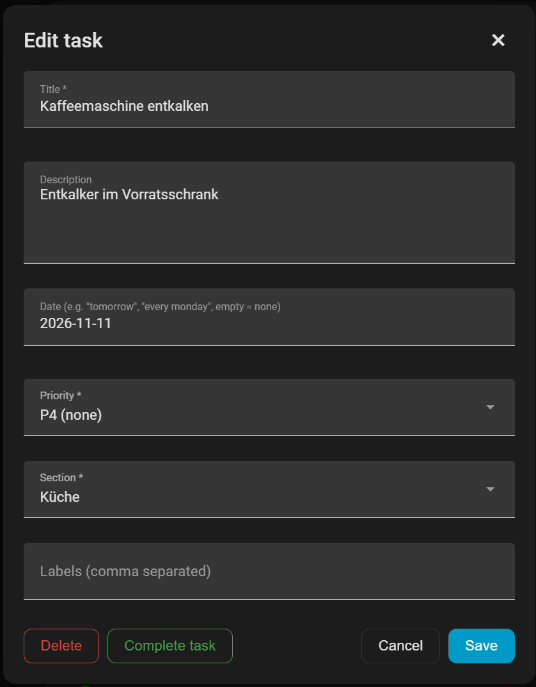
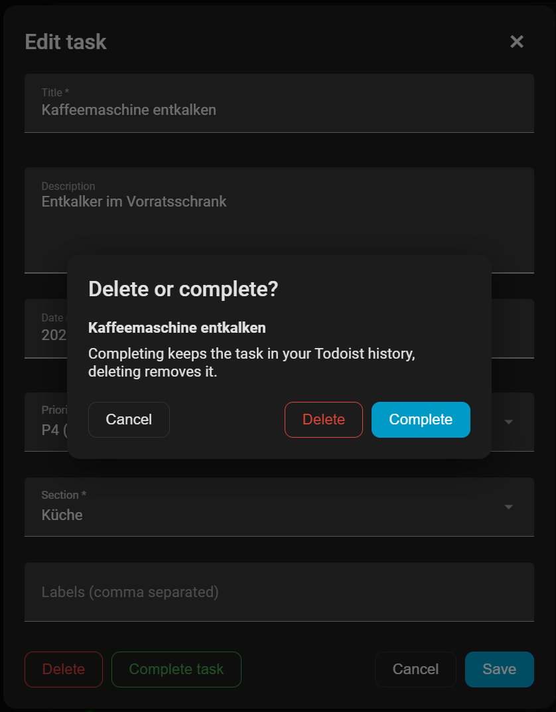

# Full setup (REST)

> [!NOTE]
> The full setup was tested against a real Todoist account: showing tasks and sections, adding, completing and undoing, editing (title, description, date, priority, labels), moving between sections, creating a section, Quick Add and deleting. Please report anything that does not work in the [issue tracker](https://github.com/ConstableW/todoist-card/issues).

The official Todoist integration only provides titles, descriptions, dates and the status of tasks. With a small REST setup the card can do more:

|                                                    | Basic (Todoist integration) | Full (REST sensor) |
| -------------------------------------------------- | :-------------------------: | :----------------: |
| Setup effort                                       | none, just pick the entity  | YAML, token, restart |
| Entity you choose in the card                      | `todo.*`                    | `sensor.*`         |
| Show tasks, descriptions                           | yes                         | yes                |
| Add, complete, undo, delete (with confirmation)    | yes                         | yes                |
| Edit title, description, date                      | yes (date picker)           | yes (date as text, also recurring) |
| Sections with task count, collapsible              | no                          | yes                |
| Move to / create sections                          | no                          | yes                |
| Priority, labels                                   | no                          | yes                |
| Quick Add                                          | no                          | yes                |

<p align="center">
  
  
</p>

The card talks to Todoist through two things in your Home Assistant configuration: a REST **sensor** that reads the project, and a **`rest_command`** that sends changes. You select the sensor in the card.

## 1. Home Assistant configuration

Add this to `configuration.yaml`:

```yaml
sensor:
  - platform: rest
    name: To-do List
    method: GET
    resource: 'https://api.todoist.com/api/v1/projects/TODOIST_PROJECT_ID/full'
    headers:
      Authorization: !secret todoist_api_token
    value_template: '{{ value_json[''project''][''id''] }}'
    json_attributes:
      - project
      - items
      - tasks
      - sections
    scan_interval: 30

rest_command:
  todoist:
    method: post
    url: 'https://api.todoist.com/api/v1/{{ url }}'
    payload: '{{ payload }}'
    headers:
      Authorization: !secret todoist_api_token
    content_type: 'application/x-www-form-urlencoded'
```

and to `secrets.yaml`:

```yaml
todoist_api_token: 'Bearer TODOIST_API_TOKEN'
```

Replace

- `TODOIST_API_TOKEN` with your [token](https://app.todoist.com/app/settings/integrations/developer). Keep the `Bearer ` part unchanged.
- `TODOIST_PROJECT_ID` with the ID of your project. Open the project in Todoist and look at the URL, for example `https://app.todoist.com/app/project/haushalt-6hwX6x6GFv8MV22c`. The ID is only the part after the last dash (`6hwX6x6GFv8MV22c`), **not** the name in front of it. The ID contains letters in API v1.

Check the configuration in _Developer tools → YAML_ and restart Home Assistant. `rest_command` is only loaded on a restart.

> **Why `items`, `tasks` and `sections`?** The card reads the tasks from `items` or, if that is missing, from `tasks`. `sections` is needed for the section grouping and for moving tasks between sections. Attributes that Todoist does not return are simply ignored.

## 2. Add the card

1. Open a dashboard, click the pencil icon (_Edit dashboard_) and then _Add card_.
2. Choose **Custom: Todoist Card**.
3. Select the sensor you created (`sensor.to_do_list`).

Or use YAML:

```yaml
type: custom:todoist-card
entity: sensor.to_do_list
mode: extended
show_header: true
show_sections: true
show_completed: 5
show_item_add: true
use_quick_add: false
show_item_close: true
show_item_delete: true
only_today_overdue: false
```

## Options

All options of the [README](../README.md#options) apply. These additional options need the full setup:

| Name            |   Type    | Default | Description                                                                                                                              |
| --------------- | :-------: | :-----: | ---------------------------------------------------------------------------------------------------------------------------------------- |
| `show_sections` | `boolean` | `true`  | Group tasks by Todoist section. Needs `sections` in the sensor's `json_attributes`.                                                      |
| `use_quick_add` | `boolean` | `false` | Add tasks with Todoist [Quick Add](https://todoist.com/help/articles/task-quick-add) (understands dates, labels, priorities in the text). |

## Sections

Tasks that belong to a Todoist section are shown below a section header with an arrow and the number of tasks. Click the header to collapse or expand the section. The state is stored per sensor in the browser (`localStorage`), so it can differ between devices. Tasks without a section are shown first, without a header. Empty sections are hidden while `only_today_overdue` is active.

Switch it off with `show_sections: false` to get one flat list.

New tasks that you add with the input field are created at the top level of the project, not inside a section. Use the edit dialog to move them.

## Extended mode

With `mode: extended` a click on the text of a task opens an edit dialog. The circle still completes the task directly.

| Field       | Notes                                                                                                                                                                       |
| ----------- | --------------------------------------------------------------------------------------------------------------------------------------------------------------------------- |
| Title       | Required.                                                                                                                                                                   |
| Description | Optional, multi-line.                                                                                                                                                       |
| Date        | Free text that Todoist parses itself, e.g. `tomorrow`, `every monday` or `15 dec`. Empty removes the date. Recurring tasks keep their rule as long as you do not change this field. |
| Priority    | P1 (highest) to P4 (none).                                                                                                                                                  |
| Section     | Moves the task to another section. _No section_ moves it to the top level of the project, _+ New section..._ creates a section with the name you enter and moves the task into it. |
| Labels      | Comma separated.                                                                                                                                                            |

Buttons: **Save** (only sends what you changed), **Cancel** or the × in the corner, **Complete task**, and **Delete** (with the same two-step confirmation as the trash bin). Errors reported by Todoist are shown in the dialog.

<p align="center">
  
</p>

Not supported: deadlines, reminders, locations, comments, sub-task hierarchy, and picking a section when adding a new task.

## Incomplete setup

The card checks what is available and adjusts itself:

- Without `rest_command.todoist` the card is **read-only**: no input, no complete or delete buttons, and a click on a task opens a details view. In the editor, the options that cannot work are hidden and one hint tells you what is missing. This also applies if your configuration still has these options switched on.
- Without the `sections` attribute there are no sections.
- Without `items` or `tasks` the card shows a notice instead of an empty list, and the editor only offers the entity.

When you complete the setup later, the card switches to the full functionality by itself. Options that the editor switched off while the setup was incomplete (add, complete, delete, Quick Add) have to be switched on again.

## Migrating from the original card

The original card `grinstantin/todoist-card` used the Todoist Sync API v9, which was shut down on 2026-02-10. Only the Home Assistant configuration changes, the card options stay the same.

| Before (`grinstantin/todoist-card`)                                        | Now                                                                         |
| -------------------------------------------------------------------------- | --------------------------------------------------------------------------- |
| sensor `resource: .../sync/v9/projects/get_data` with a `project_id` param | sensor `resource: .../api/v1/projects/TODOIST_PROJECT_ID/full`, no `params` |
| `rest_command` url `.../sync/v9/{{ url }}`                                 | `.../api/v1/{{ url }}`                                                      |
| Quick Add via `quick/add`                                                  | Quick Add via `tasks/quick` (handled by the card)                           |
| `json_attributes: project, items`                                          | `json_attributes: project, items, tasks, sections`                          |

Then:

1. Replace the card resource (HACS: remove the old repository, add this one).
2. Restart Home Assistant.
3. Reload the browser with the cache cleared (Ctrl+F5; in the companion app: _Settings → Companion app → Troubleshooting → Reset frontend cache_).

## Troubleshooting

- **The card is empty or shows a notice about missing tasks**
  Open _Developer tools → States_ and look at the sensor. Its attributes must contain `project` and `items` or `tasks`. Check that the token in `secrets.yaml` starts with `Bearer ` and that the project ID is correct.
- **The sensor is `unknown` or `unavailable`**
  Check the Home Assistant log for REST errors. HTTP 401/403 means a wrong token, 400/404 a wrong project ID. Make sure you only entered the part of the project URL after the last dash.
- **The card is read-only although I want to change tasks**
  `rest_command.todoist` is not available. Check _Developer tools → Actions_ for `rest_command.todoist` and that you restarted Home Assistant after adding it.
- **No sections are shown**
  `sections` is missing in `json_attributes`, `show_sections` is `false`, or the project has no sections. Check the sensor attributes for a `sections` list.
- **Adding, completing or editing fails**
  Errors from Todoist are shown in the edit dialog. For other actions check the Home Assistant log.
- **Log message "State attributes ... exceed maximum size of 16384 bytes"**
  Large projects produce big attributes. The card still works, only the database does not store the attributes. You can exclude the sensor from the [recorder](https://www.home-assistant.io/integrations/recorder/#configure-filter) to silence it.
- **A change shows up late**
  The card refreshes the sensor after each action, but Todoist may need a moment. The sensor is polled every `scan_interval` seconds.
